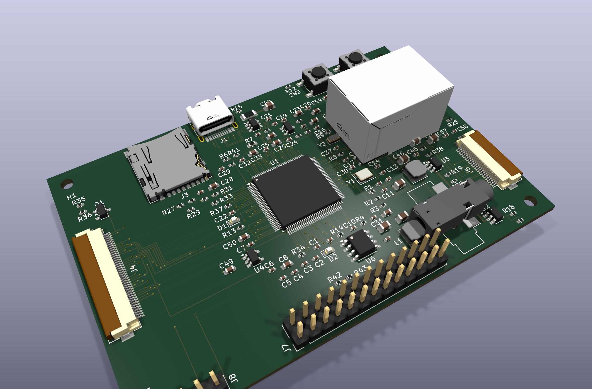

# someda for Claude Code

**Describe a circuit; get a fab-ready KiCad project with every claim checked.**

This plugin puts the [someda](https://github.com/kabidey/someda) engine behind three slash
commands. In a conversation, Claude writes the circuit as a small JSON plan — real parts with
datasheet pinouts, nets, intent such as "USB-C on the top edge" — and never a coordinate. The
compiled engine does the rest: schematic, footprints, placement, routing (differential pairs,
enforced crosstalk spacing), signal-integrity / stability / thermal audits, KiCad's own ERC and
DRC, Gerbers, drill, BOM, a JLCPCB order package and 3D renders. The build ends with six gates;
all six pass or the answer is **NOT DONE** with the failing gate named.

The engine repairs what a plan edit can fix (a misspelled footprint, a missing decoupling
capacitor, a regulator short of output capacitance, a connector with no room on its edge) and
builds again, so the plan can come from a small model, a large one, or a person.

## Install

```bash
claude plugin marketplace add kabidey/someda-claude-plugin
claude plugin install someda@someda
```

On first use the plugin resolves the engine: `someda` on your PATH, a `SOMEDA_BIN` override, or
the release binary for your platform (Linux x86_64, macOS Apple silicon and Intel, Windows
x86_64; other platforms are built from source with `cargo`). It also installs what a build
needs beyond the binary: KiCad's footprint and 3D model libraries (`apt` on Debian/Ubuntu) and
the LCSC/EasyEDA converter in a private virtualenv.

You need [KiCad](https://www.kicad.org/) with `kicad-cli` on your PATH (developed and verified
against KiCad 10.0.6). No API key is required: Claude is the planner.

Not using Claude Code? The same release archive the plugin downloads also holds `someda-app`,
a desktop window that does the whole flow with any language model provider (see the
[engine README](https://github.com/kabidey/someda#the-desktop-app)).

## What a session looks like

```
you:     /pcb-plan a 555 timer blinking an LED at about 1 Hz, 5 V in on a header
claude:  writes plan.json — NE555, timing RC, LED + resistor, 100 nF next to the 555,
         a 2-pin header on the left edge — and shows it for review

you:     /pcb-build 555 LED blinker
claude:  1. schematic written and exported to PDF for your approval
         2. fetch-libs: every footprint and 3D model FOUND or FETCHED (none MISSING)
         3. the engine builds: placement ✓  routed 15 of 15 ✓  audits ✓
            kicad-cli ERC ✓ DRC 0 errors ✓  Gerbers / drill / BOM / JLCPCB package / renders ✓
            export preflight: drc shorts unrouted pours gerbers drill = 6 / 6
         → someda-build/circuit.kicad_pcb, fab/, fab/jlcpcb/, render/, plan.built.json
```

Those numbers are the engine's quick-start plan
([examples/plan_555.json](https://github.com/kabidey/someda/blob/master/examples/plan_555.json))
built with someda 0.7.0 and kicad-cli 10.0.6.

## Commands

| Command | What it does |
|---|---|
| `/pcb-plan <description>` | Write `plan.json` following the [contract](skills/someda/references/CONTRACT.md) and show it. No build. |
| `/pcb-build <description>` | Schematic for approval → libraries fetched → build with the engine's repair rounds → honest report of every stage and gate. |
| `/pcb-check <file>` | The engine's DRC/ERC on an existing `.kicad_pcb` or `.kicad_sch`. |

The build step in detail:

1. **Schematic first.** The engine writes a readable schematic (library symbols, labelled pins) and stops; Claude exports it to PDF and asks you to approve or change the plan.
2. **Libraries.** `scripts/fetch-libs.py` pulls every footprint and 3D model the plan needs that your KiCad libraries lack: KiCad's GitLab repositories, LCSC/EasyEDA by `lcsc` part number (or `mpn`, resolved through JLCPCB's parts search), and KiCad zips you downloaded from UltraLibrarian, SnapEDA, Mouser or Digi-Key (`--import`). Every part ends **FOUND**, **FETCHED** (with its source) or **MISSING** with the plan edit to make. A MISSING name that is only a misspelling is corrected by the engine's first repair round; a part the libraries really lack is never guessed.
3. **Build.** `someda ai build` runs up to `SOMEDA_REPAIR_ROUNDS` (default 3) repair rounds by itself, printing `repair:` for what it changed and `suggest:` with the exact plan edit for what it could not; the plan as built is `someda-build/plan.built.json`.
4. **Report.** Claude reads the stage table and the audits and tells you what passed, what the warnings mean physically, and where the files are. It never claims done when a gate failed.

## What the engine does

Placement from real courtyards (mounting holes at their corners, edge connectors rotated so
their opening faces the edge and placed on it, parts next to the pins they share, keep-out
rings for fine-pitch escapes); routing on JLCPCB rules for 2, 4 or 6 layers with inner planes
and per-pad fanouts, escape vias for fine-pitch pins, differential pairs as coupled corridors
with matched lengths, 3W/5W crosstalk spacing enforced for every fast net; audits on the routed
copper (stray L/C, SWR, unterminated lines, crosstalk re-measured, decoupling loop inductance,
regulator and crystal checks, PDN |Z(f)|, junction temperatures, JLCPCB scope); kicad-cli ERC and
DRC judged from the report file; Gerbers, drill, position, detailed BOM, JLCPCB order package
(Protel-named zip, assembly BOM, CPL with rotation corrections), 3D renders with component
bodies. The [engine README](https://github.com/kabidey/someda#readme) has the full list and the
plan fields.

## A real board

[examples/sompi-v3s](examples/sompi-v3s) is an Allwinner V3s single-board computer planned this
way: 132 parts on 90 × 60 mm, six layers, USB-C, 10/100 Ethernet, microSD, SPI NOR, 40-pin LCD
and 24-pin MIPI camera FPCs, audio jack, GPIO header, two bucks and two LDOs. With someda 0.7.0
it routes 187 of 187 connections, couples all seven USB / Ethernet / MIPI pairs within their skew
budgets, has 0 crosstalk violations and kicad-cli DRC 0 errors, and passes the six gates. The
engine rotated every edge connector from its footprint, moved the audio jack to the bottom edge
when the top edge had no slot deep enough, and grew the 1.8 V plane island to reach its
capacitors. Its remaining warnings are real and listed (crystal traces of 11–17 mm, one far
capacitor, three capacitors beyond the island, board density 147 %).

The unedited outputs of that build — Gerbers, KiCad project, DRC/ERC reports, schematic PDF,
renders, BOM, JLCPCB package, checksums — are in
[examples/sompi-v3s/evidence](examples/sompi-v3s/evidence).



## What "six gates" does not mean

The boards are not simulated and have not been built. Connector pinouts follow conventions that
must be checked against the parts you buy; 3D bodies fetched from LCSC are not verified against
physical parts; clock-to-data skew across pairs is not enforced; everything is placed on the
top side. Read the warnings; they are the engine telling you what it could not make good.

## Repository

```
commands/            pcb-plan, pcb-build, pcb-check
skills/someda/       SKILL.md — how Claude plans and runs a build; references/CONTRACT.md — the plan
scripts/             setup-someda.sh (engine + libraries), fetch-libs.py (footprints and 3D models)
examples/sompi-v3s/  the SBC plan, its generator, design notes and build evidence
```

MIT license · [SomTronics](https://somtronics.org)
